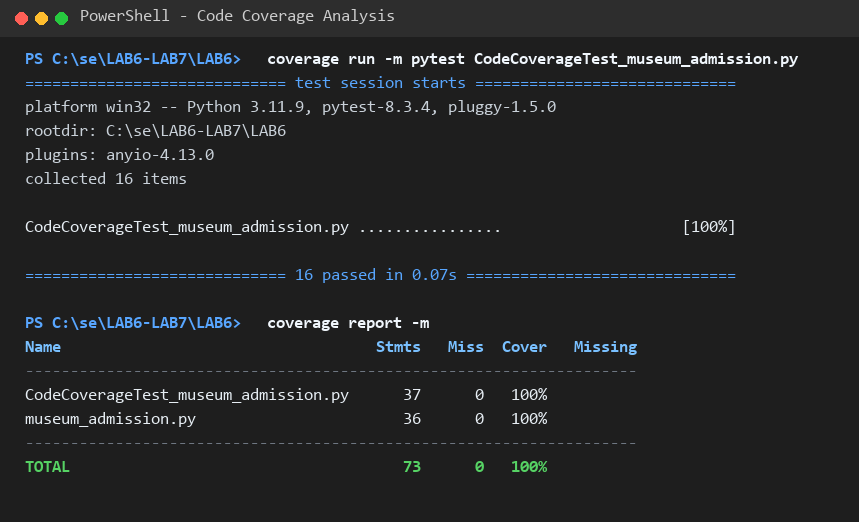
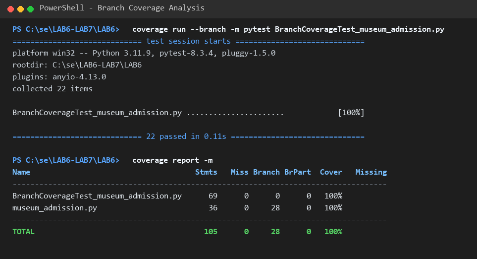

# Lab 6: Code and Branch Coverage Analysis Report

## Student Details
- **Student Roll / PRN**: PES1UG24CS478
- **Repository**: [LAB6-LAB7-SE-PES1UG24CS478](https://github.com/sujayhegde23/LAB6-LAB7-SE-PES1UG24CS478.git)
- **Application Under Test**: `LAB6/museum_admission.py`

---

## 1. Objectives & Theoretical Background

### Key Concepts:
1. **Line Coverage (Statement Coverage)**:
   - Measures the percentage of executable lines of code that were run at least once during test execution.
   - Formula: $\text{Line Coverage} = \frac{\text{Executed Statements}}{\text{Total Statements}} \times 100\%$
   - *Limitation*: 100% line coverage does not ensure that all outcomes of conditional statements are tested. For instance, an `if` without an `else` might execute its body when `True`, achieving 100% line coverage without ever testing what occurs when the condition evaluates to `False`.

2. **Branch Coverage (Decision Coverage)**:
   - Measures whether each decision point (such as `if`, `elif`, boolean expressions) evaluated to both boolean states (`True` and `False`), and whether all possible control paths were traversed.
   - Formula: $\text{Branch Coverage} = \frac{\text{Executed Branches}}{\text{Total Branches}} \times 100\%$
   - *Benefit*: Catches hidden edge cases, unhandled logical states, and false sense of security provided by pure statement coverage.

---

## 2. Initial Coverage Analysis (Baseline)

### Initial Run with Starter Test Case (`test_museum_admission.py`):
The starter test suite contained only 2 test cases:
- `test_adult_weekday`: `ticket_price("adult", 30, "tuesday", False) == 300`
- `test_small_group`: `group_discount(4, False) == 0`

### Initial Results:
- **Line Coverage**: 47% (19 statements missed out of 36)
- **Branch Coverage**: 42% (10 partial branches missed out of 28)
- **Untested Logic**:
  - `ticket_price`: invalid category, negative age, children under 5, Monday discount, Saturday & Sunday surcharge, guided tour for student vs non-student.
  - `group_discount`: invalid group size `< 1`, school group discounts (>= 20, < 20), regular group tiers (>= 15, >= 8).
  - `gallery_entry`: capacity full (`wait`), near capacity without slot (`queue`), near capacity with slot (`enter`).

---

## 3. Code Coverage Analysis (Commit 1 — Target >90%)

### Test File: `CodeCoverageTest_museum_admission.py`
A targeted test suite was constructed to execute every statement across all three functions:

| Function | Test Case | Target Statement / Branch |
|---|---|---|
| `ticket_price` | `test_adult_weekday` | Normal weekday adult ticket without tour |
| `ticket_price` | `test_ticket_price_unknown_category` | Raises `ValueError("unknown category")` |
| `ticket_price` | `test_ticket_price_negative_age` | Raises `ValueError("invalid age")` |
| `ticket_price` | `test_ticket_price_child_under_5` | Free admission for age < 5 |
| `ticket_price` | `test_ticket_price_monday_student_guided_tour` | Monday half price + student guided tour (+50) |
| `ticket_price` | `test_ticket_price_saturday_adult_guided_tour` | Saturday surcharge (+50) + adult guided tour (+100) |
| `group_discount` | `test_group_discount_invalid_size` | Raises `ValueError("invalid group size")` |
| `group_discount` | `test_group_discount_school_large` | School group >= 20 -> 40% discount |
| `group_discount` | `test_group_discount_school_small` | School group < 20 -> 25% discount |
| `group_discount` | `test_group_discount_regular_large` | Regular group >= 15 -> 20% discount |
| `group_discount` | `test_group_discount_regular_medium` | Regular group >= 8 -> 10% discount |
| `group_discount` | `test_group_discount_regular_small` | Regular group < 8 -> 0% discount |
| `gallery_entry` | `test_gallery_entry_wait` | At capacity -> returns `"wait"` |
| `gallery_entry` | `test_gallery_entry_queue` | >= 90% capacity without timed slot -> returns `"queue"` |
| `gallery_entry` | `test_gallery_entry_enter` | Below threshold -> returns `"enter"` |

### Code Coverage Results:
```
Name                                   Stmts   Miss  Cover   Missing
--------------------------------------------------------------------
CodeCoverageTest_museum_admission.py      37      0   100%
museum_admission.py                       36      0   100%
--------------------------------------------------------------------
TOTAL                                     73      0   100%
```
- **Code Coverage Achieved**: **100%** (Exceeds 90% requirement).

### Terminal Output Screenshot:


---

## 4. Branch Coverage Analysis (Commit 2 — Target >90%)

### Test File: `BranchCoverageTest_museum_admission.py`
To achieve 100% branch coverage, every decision path, boolean operand combination, and boundary condition was systematically addressed:

### Decision & Branch Coverage Matrix:

1. **`ticket_price`**:
   - `category not in BASE_PRICE`: Evaluated `True` (invalid string `"alien"`) and `False` (all categories: `"adult"`, `"student"`, `"child"`, `"senior"`).
   - `age < 0`: Evaluated `True` (`-1`) and `False` (`0`).
   - `age < 5`: Evaluated `True` (`0`, `4`) and `False` (boundary at `5`).
   - `day == "monday"`: Evaluated `True` (Monday) and `False` (other days).
   - `elif day in ("saturday", "sunday")`:
     - `saturday`: `True` (+50)
     - `sunday`: `True` (+50)
     - other days (`tuesday`, `wednesday`, etc.): `False` (no weekend fee)
   - `if with_guided_tour`: Evaluated `False` (no tour) and `True` (with tour).
     - Sub-decision `category == "student"`: Evaluated `True` (+50) and `False` (+100 for adult, senior).

2. **`group_discount`**:
   - `group_size < 1`: Evaluated `True` (`0`, `-10`) and `False` (`>= 1`).
   - `if is_school`: Evaluated `True` and `False`.
     - When `True`:
       - `group_size >= 20`: Evaluated `True` (`20`, `30`) and `False` (`19`, `1`).
     - When `False`:
       - `group_size >= 15`: Evaluated `True` (`15`, `22`) and `False` (`14`).
       - `elif group_size >= 8`: Evaluated `True` (`8`, `14`) and `False` (`7`, `1`).

3. **`gallery_entry`**:
   - `visitors_inside >= capacity`: Evaluated `True` (`100`, `105`) and `False` (`89`, `90`, `95`).
   - `if visitors_inside * 10 >= capacity * 9 and not has_timed_slot`:
     - Case A (`True` and `True`): `visitors_inside=90, capacity=100, has_timed_slot=False` -> `"queue"`
     - Case B (`True` and `False`): `visitors_inside=90, capacity=100, has_timed_slot=True` -> bypassed to `"enter"`
     - Case C (`False`): `visitors_inside=89, capacity=100` -> `"enter"`

### Branch Coverage Results:
```
Name                                     Stmts   Miss Branch BrPart  Cover   Missing
------------------------------------------------------------------------------------
BranchCoverageTest_museum_admission.py      69      0      0      0   100%
museum_admission.py                         36      0     28      0   100%
------------------------------------------------------------------------------------
TOTAL                                      105      0     28      0   100%
```
- **Branch Coverage Achieved**: **100%** (28/28 branches covered, 0 partial branches).

### Terminal Output Screenshot:


---

## 5. Comparison: Line Coverage vs. Branch Coverage

| Metric | Initial Test | After Code Coverage Tests | After Branch Coverage Tests |
|---|---|---|---|
| **Test Cases** | 2 | 16 | 22 |
| **Executable Statements** | 36 | 36 | 36 |
| **Statements Missed** | 19 | 0 | 0 |
| **Line Coverage** | 47% | **100%** | **100%** |
| **Total Branches** | 28 | 28 | 28 |
| **Partial / Untested Branches** | 10 | 0 | **0** |
| **Branch Coverage** | 42% | 100% | **100%** |

### Summary & Key Takeaways:
- Line coverage validates statement execution, while branch coverage validates logic decision integrity across all control pathways.
- Testing edge cases and boundary conditions (e.g. `age=4` vs `age=5`, `group_size=19` vs `20`, gallery capacity `89` vs `90` vs `100`, and short-circuit condition interactions) ensures complete robustness and eliminates untested code branches.
