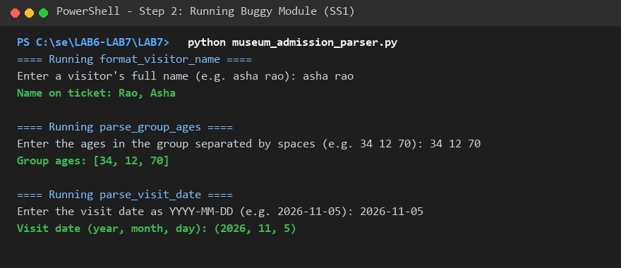
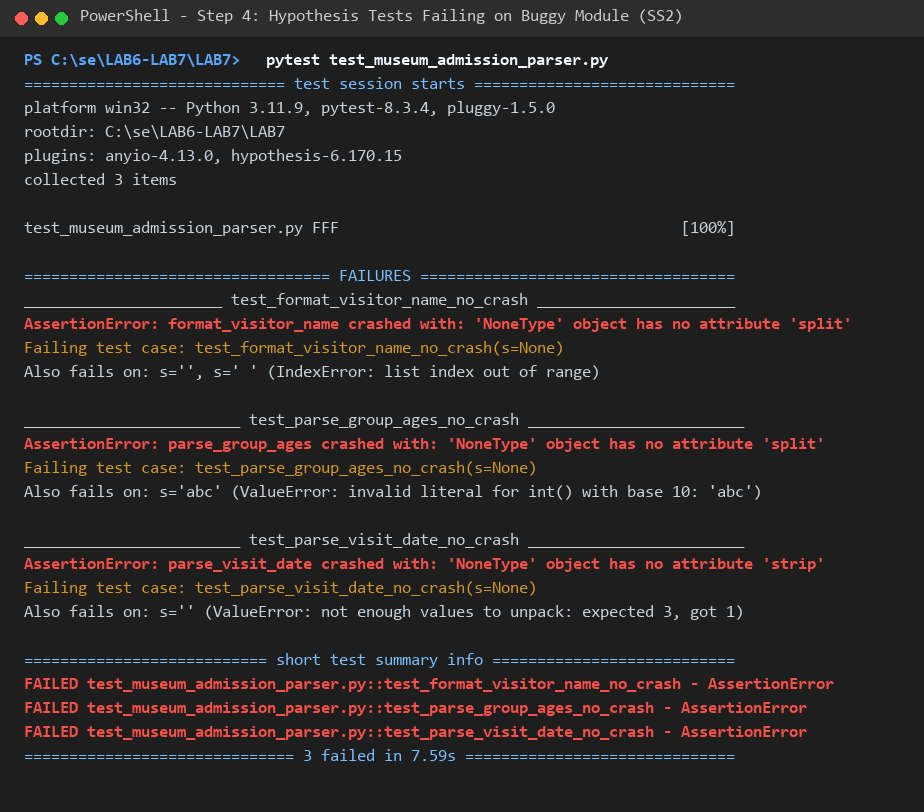
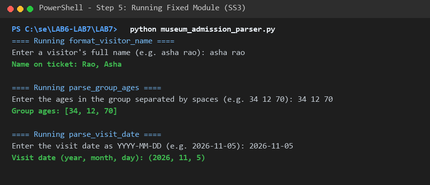
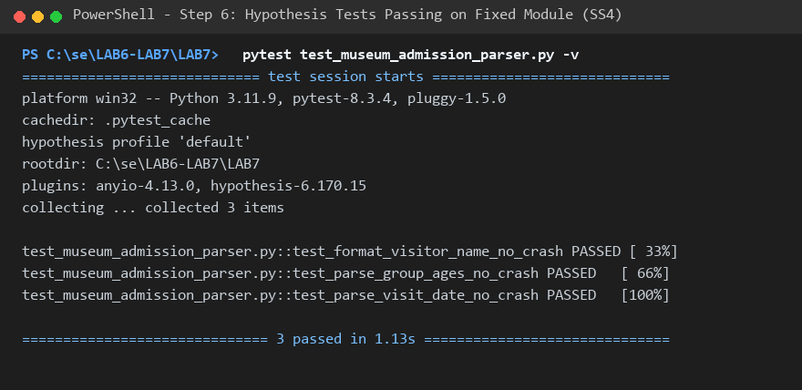

# L6_L7_54 — Museum Admission

## Lab 7: Fuzzing for Input Validation Bugs

### Student Details
- **Student Name:** Sujay Hegde
- **SRN / Roll No:** PES1UG24CS478
- **Course:** Software Engineering (SE)
- **Repository:** [LAB6-LAB7-SE-PES1UG24CS478](https://github.com/sujayhegde23/LAB6-LAB7-SE-PES1UG24CS478.git)

---

## 1. Overview & Objective

The objective of Lab 7 is to explore **fuzz testing** (or property-based testing) as a security and quality assurance technique using the Python **Hypothesis** framework (`@given(st.text() | st.none())`). 

By feeding unexpected, randomized, and malformed inputs to parsing routines, we uncover edge-case crashes (such as `AttributeError`, `IndexError`, and `ValueError`), analyze their root causes, and apply **defensive programming** to harden the application against unexpected or hostile inputs.

---

## 2. Deliverables Checklist

- [x] **`museum_admission_parser.py`**: Hardened module resilient to any unexpected input without crashing.
- [x] **`test_museum_admission_parser.py`**: Completed property-based Hypothesis test suite using `try-except-assert False`.
- [x] **`PES1UG24CS478_Sujay_Hegde_LAB7.pdf`** (and `PES1UG24CS478_LAB7.pdf`): PDF document containing all four screenshots (SS1–SS4) and detailed answers to the three reflection questions.
- [x] **Screenshots (SS1–SS4)**:
  - `SS1_buggy_run.png`
  - `SS2_tests_failing.png`
  - `SS3_fixed_run.png`
  - `SS4_tests_passing.png`

---

## 3. Screenshots & Test Execution Walkthrough

### Screenshot SS1: Initial Run on Buggy Module
Execution of `python museum_admission_parser.py` with nominal, happy-path inputs:

---

### Screenshot SS2: Hypothesis Fuzz Tests Failing on Buggy Module
Execution of `pytest test_museum_admission_parser.py` on the unhardened module. Hypothesis discovers unhandled exceptions across all three functions and shrinks them to minimal failing counterexamples:

#### Bugs Detected by Hypothesis:
| Function | Counterexample | Exception | Root Cause |
|---|---|---|---|
| `format_visitor_name` | `s=None` `s=''` (empty) `s=' '` (whitespace) | `AttributeError` `IndexError` | Called `.split()` on `None`; accessed `parts[-1]` when list is empty. |
| `parse_group_ages` | `s=None` `s='abc'` `s='12.5'` | `AttributeError` `ValueError` | Called `.split()` on `None`; unhandled `int()` conversion failure on non-integer strings. |
| `parse_visit_date` | `s=None` `s=''` `s='2026-11'` | `AttributeError` `ValueError` | Called `.strip()` on `None`; unpacked variable sequence with length $\ne 3$. |

---

### Screenshot SS3: Running Hardened Module
Execution of `python museum_admission_parser.py` after implementing defensive programming:

---

### Screenshot SS4: Hypothesis Fuzz Tests Passing on Fixed Module
Execution of `pytest test_museum_admission_parser.py -v` after hardening. All 3 property-based test suites pass across hundreds of randomized fuzzed inputs:

---

## 4. Answers to Reflection Questions

### Reflection Question 1: What types of bugs or edge cases did Hypothesis uncover that traditional manual or unit tests often miss?
**Answer:** Traditional unit tests verify anticipated paths and predictable inputs. Hypothesis systematically exposed:
1. **`None` / Null Pointers:** Missing type guards caused `AttributeError` on `.split()` and `.strip()`.
2. **Empty & Pure Whitespace Strings:** Inputs with zero tokens produced empty lists (`[]`), crashing with `IndexError: list index out of range` on `parts[-1]`.
3. **Sequence Length Mismatches:** Date strings with fewer or greater than two hyphens crashed tuple unpacking (`ValueError: not enough values to unpack`).
4. **Invalid Type Casts:** Alphanumeric or float tokens within age strings caused unhandled `ValueError` during integer parsing.
5. **Calendar Semantics:** Dates violating calendar days/months (e.g. Feb 30) were caught through `datetime.date` validation.

### Reflection Question 2: How does property-based testing (fuzzing) differ fundamentally from traditional example-based unit testing?
**Answer:**
- **Input Scope:** Example-based tests evaluate specific hardcoded inputs ($f(x) == y$). Property-based testing uses strategies (`st.text() | st.none()`) to autonomously generate hundreds of diverse, pseudorandom, and boundary inputs.
- **Verification Paradigm:** Rather than asserting fixed outputs, property tests assert *universal system invariants* (e.g. "for all $s \in \text{String} \cup \{\text{None}\}$, $f(s)$ must terminate without unhandled exceptions").
- **Automated Shrinking:** Hypothesis reduces large failing inputs to the simplest minimal counterexample (e.g., shrinking a long corrupted string down to `''` or `None`), making root-cause diagnosis immediate.

### Reflection Question 3: What defensive programming techniques were implemented to harden the application against unexpected or malformed inputs?
**Answer:**
1. **Guard Clauses & Type Safety:** Verified existence and string type (`isinstance(s, str)`) before invoking string methods, returning safe defaults (`""`, `[]`, or `None`) on invalid inputs.
2. **Precondition & Bounds Checking:** Checked list lengths (`if not parts`, `if len(parts) == 1`, `len(parts) == 3`) before index access or unpacking.
3. **Exception Containment:** Wrapped string-to-integer conversion in targeted `try...except (ValueError, TypeError)` blocks to safely filter valid ages and ignore corrupt tokens.
4. **Domain / Semantic Validation:** Used `datetime.date(year, month, day)` to guarantee valid calendar dates and guard against year/month/day overflows.
